# MeghVault — Modern Cloud Storage & Collaboration Engine

<div align="center">


**A high-performance, self-hosted, enterprise-ready cloud drive offering zero-buffer streaming uploads, multi-cloud data integration, relationship-based access control, and a production-grade 5-tier security defense architecture.**

[Getting Started](#-getting-started) • [Visual Showcase](#-application-preview--interface-showcase) • [Full-Stack Architecture](#-full-stack-system-architecture) • [Security Pipeline](#2-5-tier-defensive-security-pipeline) • [NoSQL Schema Architecture](#15-mongodb-document-architecture--schema-design-nosql) • [API Catalog](#16-rest-api-complete-catalog)

<br/>
<br/>

<a href="./screenshots/CloudVaultLight.png">
  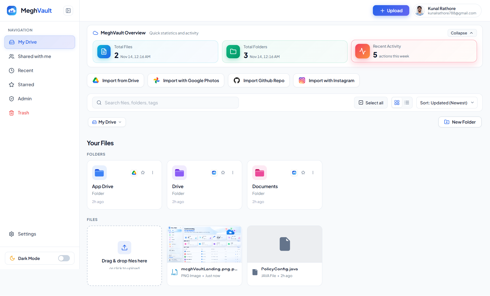
</a>

*Modern Glassmorphic Cloud Storage Dashboard featuring aesthetic, quick metrics, multi-cloud imports, and tree navigation.*

</div>

---

## 📸 Application Preview & Interface Showcase

Explore the primary views, workspaces, and workflows across MeghVault:

| Dark Mode Workspace (Default) | Accessible Light Theme |
| :---: | :---: |
| [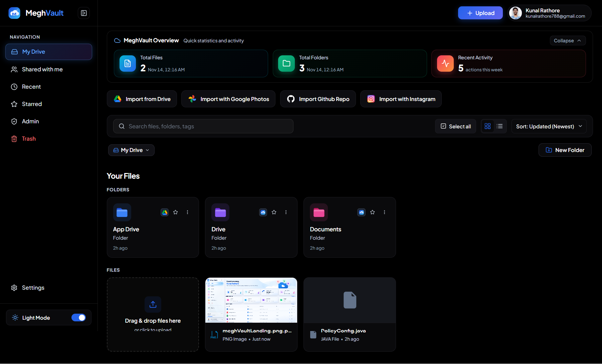](./screenshots/CloudVaultDark.png)<br/>**Flagship Dark Theme**<br/><sub>Quick overview metrics, multi-cloud import bar, and folder cards.</sub> | [](./screenshots/CloudVaultLight.png)<br/>**Accessible Light Theme**<br/><sub>Clean, high-contrast workspace for well-lit environments.</sub> |

| Starred Favorites & Fast Access | Chronological Activity Audit Stream |
| :---: | :---: |
| [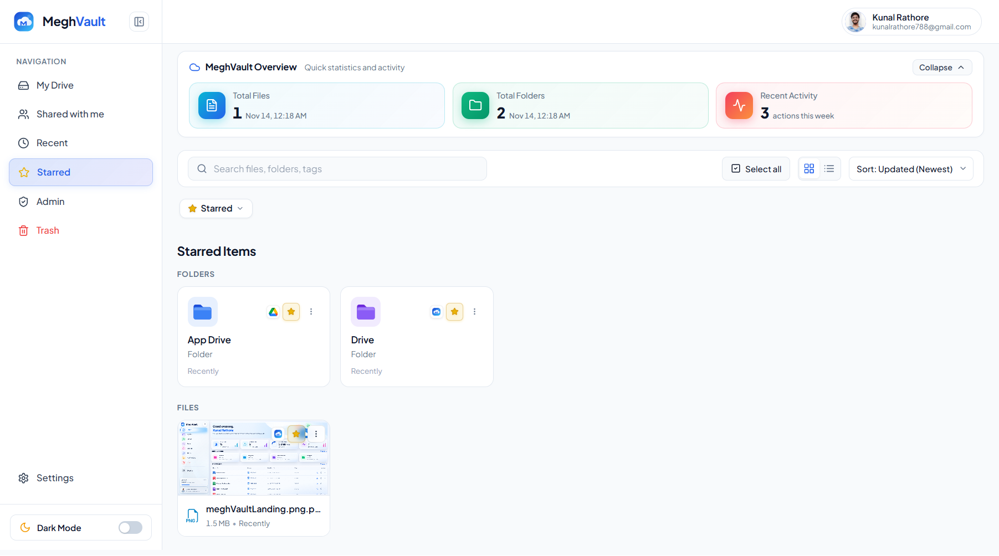](./screenshots/CloudVaultStar.png)<br/>**Starred / Favorites Drive**<br/><sub>One-click bookmarking for mission-critical documents and folders.</sub> | [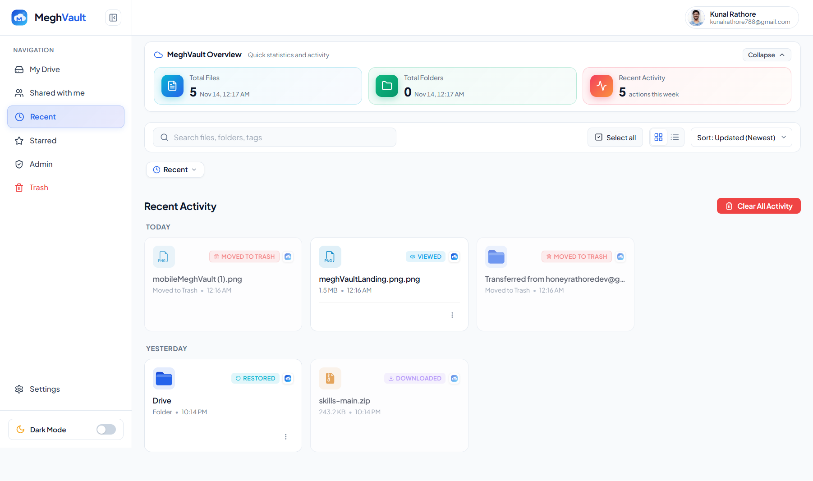](./screenshots/CloudVaultRecent.png)<br/>**Recent Activities Timeline**<br/><sub>Real-time event stream logging uploads, views, downloads, and shares.</sub> |

| Trash Management (Two-Stage Recycle Bin) | Privacy, Security & Session Management |
| :---: | :---: |
| [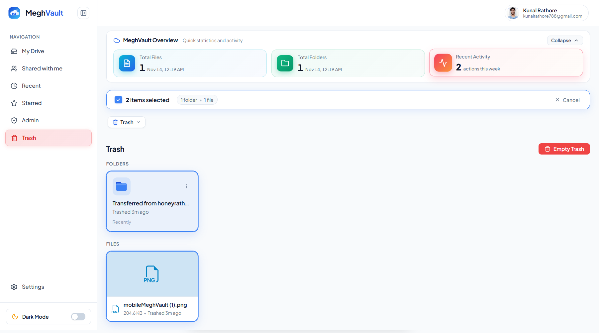](./screenshots/CloudVaultTrash.png)<br/>**Two-Stage Trash & Restoration**<br/><sub>Soft deletion with restoration pointers and permanent atomic cascade wipe.</sub> | [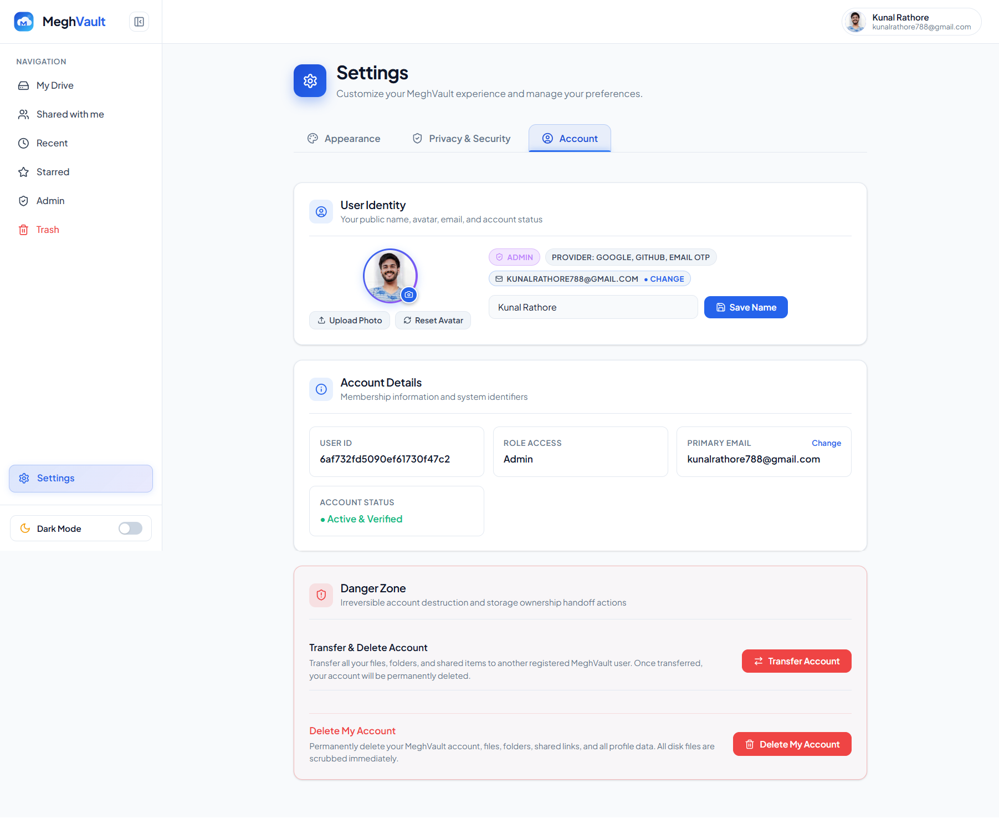](./screenshots/CloudVaultSettings.png)<br/>**Security & Identity Governance**<br/><sub>Session management, multi-device revocation, and dual-OTP authentication.</sub> |

<div align="center">

### 🛡️ Enterprise Administration & Quota Governance
<a href="./screenshots/CloudVaultAdmin.png">
  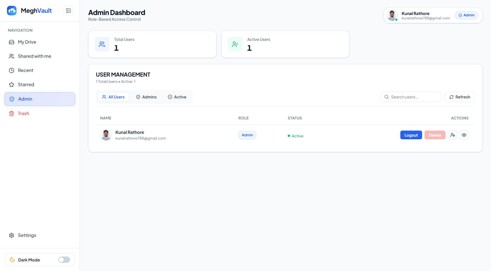
</a>

*Comprehensive administrative oversight: system storage consumption, total registered users, active sessions, and role authorization.*

</div>

---

## 📖 What is MeghVault?

**MeghVault** (inspired by the Sanskrit word *Megh* meaning "Cloud") is an open-source, private cloud storage solution designed to give individuals and teams complete control over their files, documents, and media assets.

Unlike traditional cloud drives that lock your data into proprietary ecosystems, MeghVault gives you:
- **Direct Streaming Uploads**: Zero RAM buffering on the server, streaming files of any size directly to disk.
- **Unified Cloud Importer**: Bring in assets directly from Google Drive, Google Photos, and GitHub with a single click.
- **Bank-Grade 5-Tier Security Guard**: Rate limiting, brute-force throttling, recursive XSS sanitization, Zod schema validation, and ReBAC session guards.
- **Enterprise Account Safety**: Dual-OTP email changes, account ownership transfers, and permanent atomic deletion cascades.

---

## 🏗️ Full-Stack System Architecture

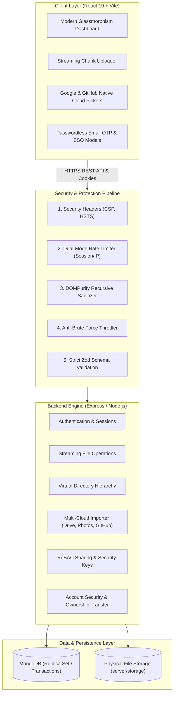

---

## 🛠️ Technology Stack

| Layer | Technologies |
| :--- | :--- |
| **Frontend** | React 19, Vite, Tailwind CSS, Lucide Icons, Iconify, React Router DOM |
| **Backend** | Node.js (v20+), Express.js, Mongoose 8, Archiver |
| **Database** | MongoDB 6.0+ (Replica Set required for ACID transactions) |
| **Security & Validation** | DOMPurify, JSDOM, Zod, express-rate-limit, crypto (HMAC & AES-256-GCM) |
| **Authentication** | Passwordless Email OTP (Resend API), Google OAuth 2.0 (OIDC), GitHub OAuth 2.0 |
| **Third-Party APIs** | Google Drive API, Google Photos Picker API, GitHub REST API, Resend |

---

## 📁 Repository Structure

```
meghvault/
├── client/                     # Frontend React 19 Single Page Application
│   ├── src/
│   │   ├── api/                # API client modules (fileApi, authApi, etc.)
│   │   ├── components/         # Reusable UI components & modals
│   │   ├── context/            # AuthContext, ToastContext, UploadContext
│   │   ├── pages/              # DrivePage, AuthPage, SettingsPage
│   │   └── utils/              # Client helpers, sanitizers & pickers
│   ├── .env.example            # Client environment template
│   └── vite.config.js          # Vite build & development proxy configuration
│
├── server/                     # Backend Express Engine & API Gateway
│   ├── config/                 # Database connection & setup scripts
│   ├── controller/             # Business logic controllers
│   ├── middlewares/            # Security headers, rate limiters, sanitizers
│   ├── models/                 # Mongoose schemas (User, File, Directory, etc.)
│   ├── routes/                 # REST API route declarations
│   ├── services/               # OAuth, encryption, email OTP services
│   ├── storage/                # Canonical physical file storage directory
│   ├── utils/                  # Cookie, token, and storage path utilities
│   ├── validators/             # Zod schema validation rules
│   ├── .env.example            # Server environment template
│   ├── app.js                  # Express application entrypoint
│   └── README.md               # Dedicated Backend Architecture Guide
│
├── .gitignore                  # Monorepo git ignore rules
└── README.md                   # Master Documentation (this file)
```

---

## ⚡ Getting Started

### 1. Prerequisites
- **Node.js**: v18.0.0 or higher (v20+ recommended)
- **MongoDB**: v6.0+ running with a **Replica Set** (required for atomic multi-document transactions)
- **Resend Account**: Free API key from [resend.com](https://resend.com) for sending OTP emails

### 2. Configure Environment Files

#### Backend Setup:
```bash
cd server
cp .env.example .env
```
Fill in the values in `server/.env`:
```env
PORT=4000
NODE_ENV=development
MONGO_URI=mongodb://localhost:27017/meghvault?replicaSet=rs0
MY_SECERT_KEY=your_random_32_character_secret_key
RESEND_KEY=re_your_resend_api_key
TOKEN_ENCRYPTION_SECRET=your_64_character_hex_key
```

#### Frontend Setup:
```bash
cd ../client
cp .env.example .env
```
Fill in the values in `client/.env`:
```env
VITE_API_URL=http://localhost:4000
VITE_GOOGLE_CLIENT_ID=your_google_client_id.apps.googleusercontent.com
VITE_GITHUB_CLIENT_ID=your_github_client_id
```

### 3. Run the Development Servers

Open two terminal tabs:

**Terminal 1 (Backend):**
```bash
cd server
npm install
npm run dev
# Backend starts on http://localhost:4000
```

**Terminal 2 (Frontend):**
```bash
cd client
npm install
npm run dev
# Frontend starts on http://localhost:5173
```

Navigate to `http://localhost:5173` in your browser.

---

# 🧠 Comprehensive Backend Architecture & Functional Flowcharts

---

## 1. High-Level Architecture & Component Topology

MeghVault's backend acts as an API gateway, streaming storage orchestrator, and security perimeter.

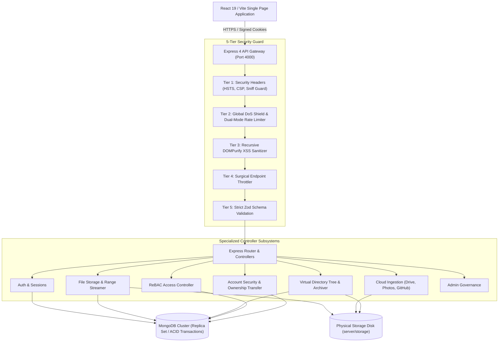

---

## 2. 5-Tier Defensive Security Pipeline

Every single HTTP request passes through five consecutive protection tiers before reaching business logic controllers.

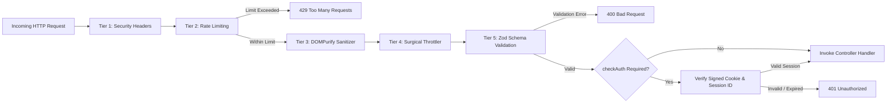

### 2.1 Production Security Headers
- **Implementation**: Injects security headers including `Content-Security-Policy`, `X-Content-Type-Options: nosniff`, `X-Frame-Options: SAMEORIGIN`, `Strict-Transport-Security`, `Referrer-Policy: strict-origin-when-cross-origin`, and `Permissions-Policy`.
- **Analogy**: Like bulletproof glass and access control doors at an enterprise data center entrance.

### 2.2 Dual-Mode Rate Limiting
- **Implementation**:
  - **Authenticated Users**: Rate-limits by verified session cookie (`sess_<sid>`). Corporate offices or college campuses sharing a single external IP address will not suffer communal IP lockouts.
  - **Unauthenticated Visitors**: Normalizes the IP address with RFC-compliant IPv6 `/64` subnet masking to prevent IP-hopping evasion.
- **Limits**:
  - Global Shield: 600 requests per 15 minutes.
  - OTP Dispatch: 5 requests per 10 minutes.
  - Verification: 10 attempts per 15 minutes.

### 2.3 Surgical Request Throttling
- **Implementation**: Injects an artificial computational delay (400ms – 1000ms) on brute-force sensitive endpoints (OTP checking, password verification on share links, permanent deletion).
- **Why it matters**: Even if an attacker spins up 1,000 threads, each verification cycle is slowed down, neutralizing dictionary attacks.

### 2.4 Recursive DOMPurify Sanitization
- **Implementation**: Recursively walks `req.body`, `req.query`, and `req.params`, scrubbing `<script>`, `onerror=`, `onload=`, `javascript:` URI schemes, and embedded SVGs while preserving normal filenames, unicode characters, and alphanumeric paths.

### 2.5 Zod Schema Validation Pipeline
- **Implementation**: Strictly validates data types, trims strings, checks valid MongoDB ObjectIDs, and returns formatted error arrays before controllers run.

---

## 3. Authentication & Session Engine

### 3.1 Passwordless Email OTP Dispatch
Generates a random 4-digit numeric code with a 3-minute TTL and dispatches it via Resend API.

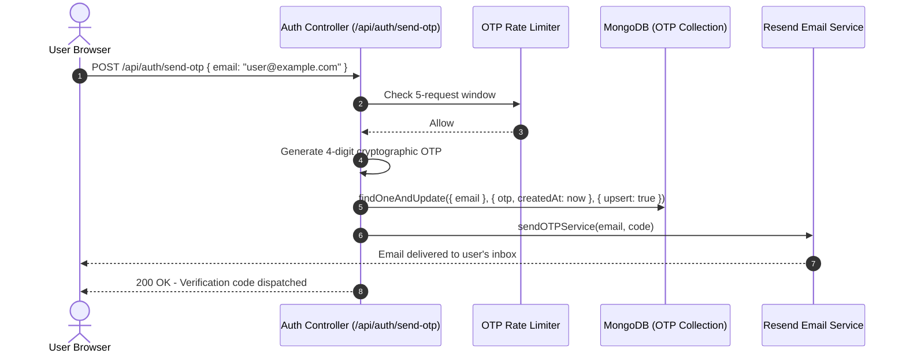

### 3.2 Passwordless Email OTP Verification & Account Creation
Verifies the submitted 4-digit code. If the user does not exist, it provisions their user document, auto-generates a unique profile avatar, creates their root directory (`rootDirId`), and issues a signed HTTP-only session cookie.

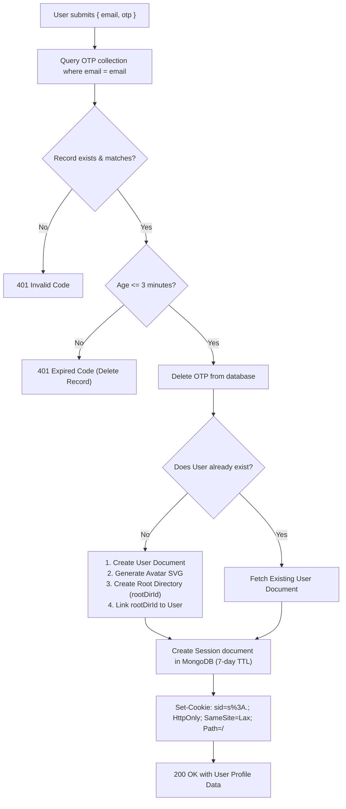

### 3.3 Google OAuth 2.0 Single Sign-On (OIDC)
Implements state-token CSRF defense and ID token cryptographic verification.

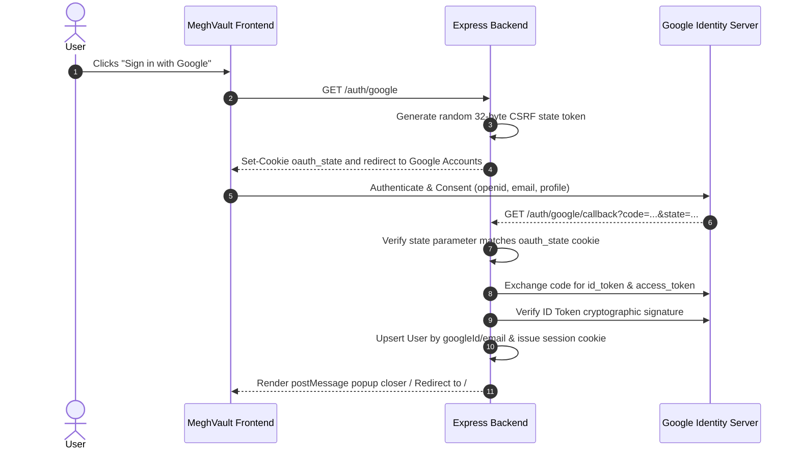

### 3.4 GitHub OAuth 2.0 Developer Sign-In
Similar to Google OAuth, exchanges the temporary GitHub authorization code, queries GitHub's `/user` and `/user/emails` API to fetch the verified primary email address, links `authProvider.githubAuth`, and provisions an authenticated session.

### 3.5 Session Management, Single Device Logout & Global Multi-Device Revocation
- **Single Logout (`POST /api/user/logout`)**: Deletes the specific `Session` record matching `req.signedCookies.sid` and clears the cookie from the browser.
- **Global Multi-Device Revocation (`POST /api/user/logout-all`)**: Executes `Session.deleteMany({ userId: req.foundUser._id })`, terminating all active sessions on other laptops, desktops, and mobile devices immediately.

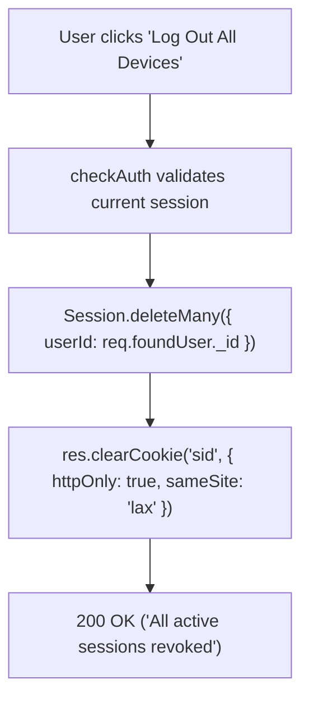

---

## 4. Virtual File System (VFS) & Directory Engine

### 4.1 Root Directory Provisioning & Hierarchy Management
When a user registers, MeghVault automatically provisions a root directory:
```javascript
const rootDir = await Directory.create({
  name: "root",
  userId: newUser._id,
  parentDirId: null,
});
newUser.rootDirId = rootDir._id;
```
Every subsequent file or subfolder has a non-null `parentDirId` that points upward in the tree.

### 4.2 Directory Browsing & Dynamic Breadcrumbs Resolution
When browsing `GET /api/directory/:id`:
1. Verifies the user owns the directory or has collaborator access.
2. Fetches child folders: `Directory.find({ parentDirId: id, isTrashed: false })`.
3. Fetches child files: `File.find({ parentDirId: id, isTrashed: false })`.
4. Dynamically climbs `parentDirId` pointers to generate the breadcrumb trail back to root.

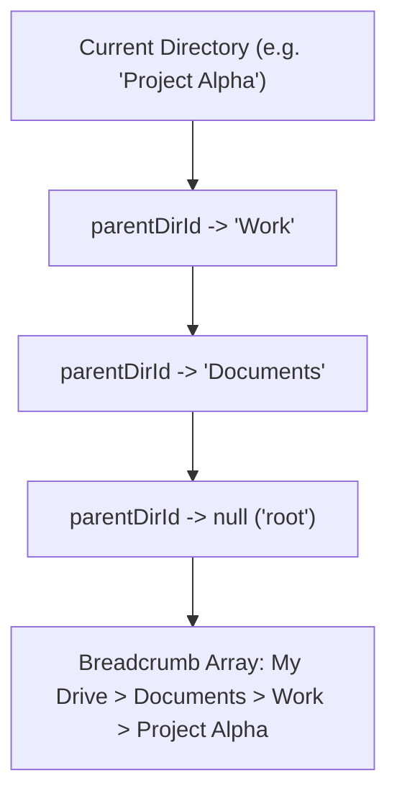

### 4.3 Directory Creation & Subfolder Nesting
`POST /api/directory` or `POST /api/directory/:id`:
Checks for duplicate directory names under the same `parentDirId`. If a folder named "Projects" already exists under the parent, it returns `409 Conflict`.

### 4.4 Directory Rename & Duplicate Conflict Prevention
`PATCH /api/directory/:id`:
Validates that the new name is non-empty, checks that no sibling directory already uses the requested name, and logs a `rename` activity.

### 4.5 Folder Archiving & On-The-Fly ZIP Streaming
Allows users to download any folder and its nested contents as a single ZIP file without writing temporary files to the server's disk:

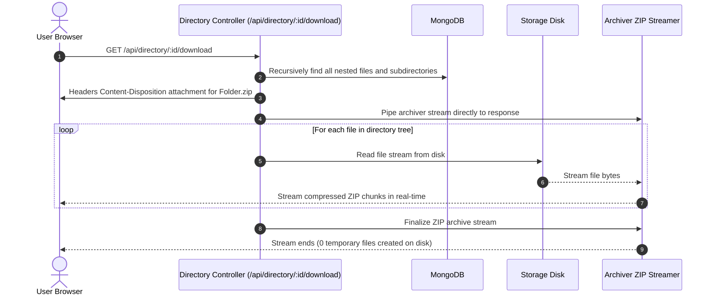

---

## 5. File Storage, Upload & Streaming Engine

### 5.1 Direct Binary Stream Upload to Physical Disk
MeghVault uploads files directly from the incoming HTTP request stream into `server/storage/<fileId>.<ext>`, maintaining constant memory consumption.

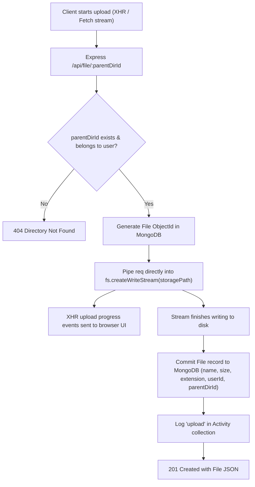

### 5.2 File Download & In-Browser Preview Resolution
When accessing `GET /api/file/:id/:filename?`:
- If `action=download` is present: `Content-Disposition: attachment; filename="Report.pdf"` (Forces browser download).
- If viewing in preview: `Content-Disposition: inline; filename="Report.pdf"` (Allows native browser PDF viewer, image canvas, or video player to render the asset directly).

### 5.3 HTTP 206 Partial Content Range Media Streaming
Enables seekable playback for audio and video files:

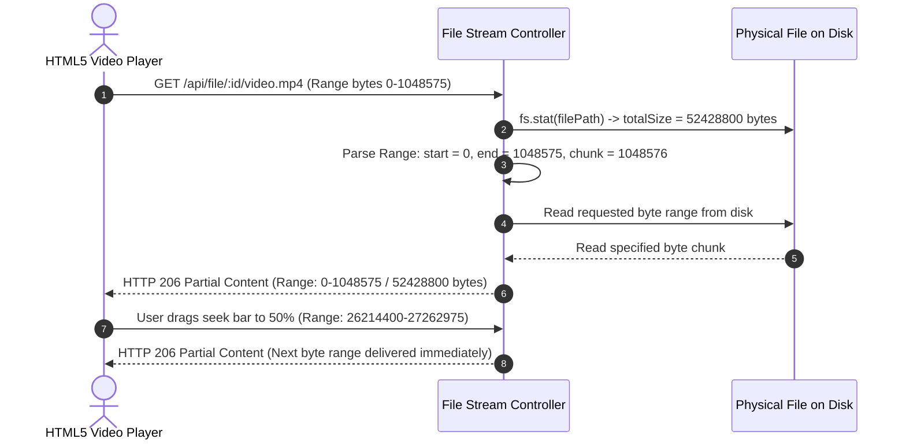

### 5.4 File Rename with Extension Preservation
`PATCH /api/file/:id`:
Validates the new name. If the user omits the extension, the backend automatically preserves the original file extension to prevent corrupting file associations.

### 5.5 Temporary One-Time Media Streaming Tickets
For secure media embeds where passing signed cookies isn't feasible (such as cross-origin `` or `<video>` tags), MeghVault supports short-lived, HMAC-signed URL tickets (`?ticket=...`).


---

## 6. Multi-Cloud Integration Pipeline

### 6.1 Google Drive Integration & AES-256-GCM Token Encryption
When a user connects Google Drive:
1. Google returns an `access_token` and an offline `refresh_token`.
2. The `refresh_token` is encrypted using **AES-256-GCM** with a 16-byte random initialization vector (IV) and an authentication tag:
   ```
   iv:authTag:encryptedCipherHex
   ```
3. Stored securely inside the user's `integrations.googleDrive` schema.

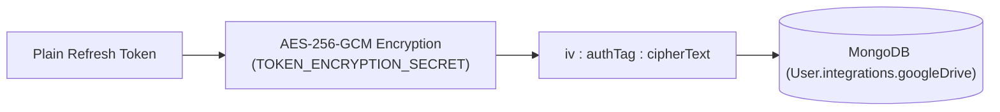

### 6.2 Google Drive Cloud File & Folder Ingestion
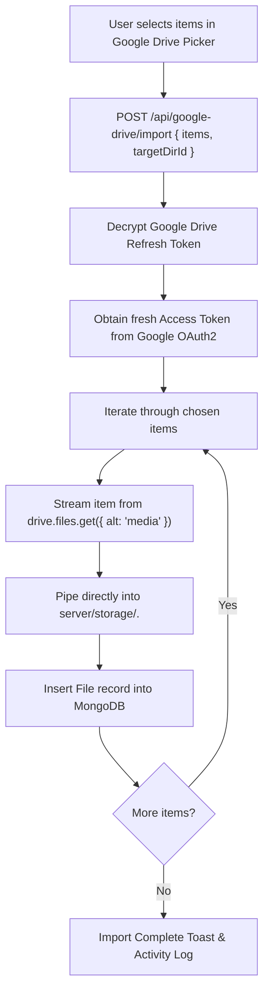

### 6.3 Google Photos Official Picker API Integration
Uses Google's official `photospicker.googleapis.com` API:
1. `POST /api/google-photos/picker-session`: Creates an ephemeral picking session.
2. Returns `pickerUri` to frontend, opening Google's secure photo selection dialog.
3. The backend polls `GET /v1/sessions/:id` until the user finishes selection.
4. Selected photo media items are downloaded directly into storage via authenticated streams.

### 6.4 Google Photos Media Ingestion Pipeline
Downloads the high-resolution photo/video stream using the authenticated Google Photos media endpoint and attaches `source: "google-photos"` metadata to the file.

### 6.5 GitHub Repository Integration & Branch Resolution
Users can browse their public and private repositories, select branches, and view repository trees.

### 6.6 GitHub Repository Tree Import (ZIP or Unpacked Tree)
- **ZIP Format**: Downloads the GitHub zipball archive directly into the user's chosen folder.
- **Folder Format**: Unpacks the GitHub archive dynamically in memory and reconstructs the repository's entire folder hierarchy as native MeghVault `Directory` and `File` entities.

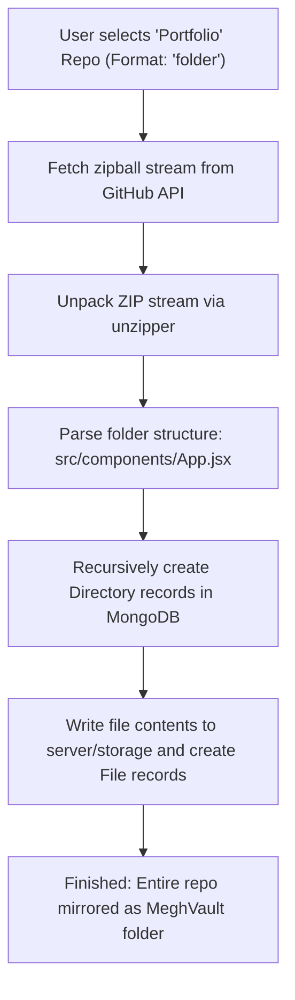

---

## 7. Sharing & Relationship-Based Access Control (ReBAC)

### 7.1 Direct Collaborator Sharing & Permission Roles
Owners can add registered users by email address with two privilege tiers:
- `viewer`: Can preview and download the resource. Cannot rename, delete, move, or modify link settings.
- `collaborator` (`editor`): Can upload files into shared folders, rename files, and organize contents.

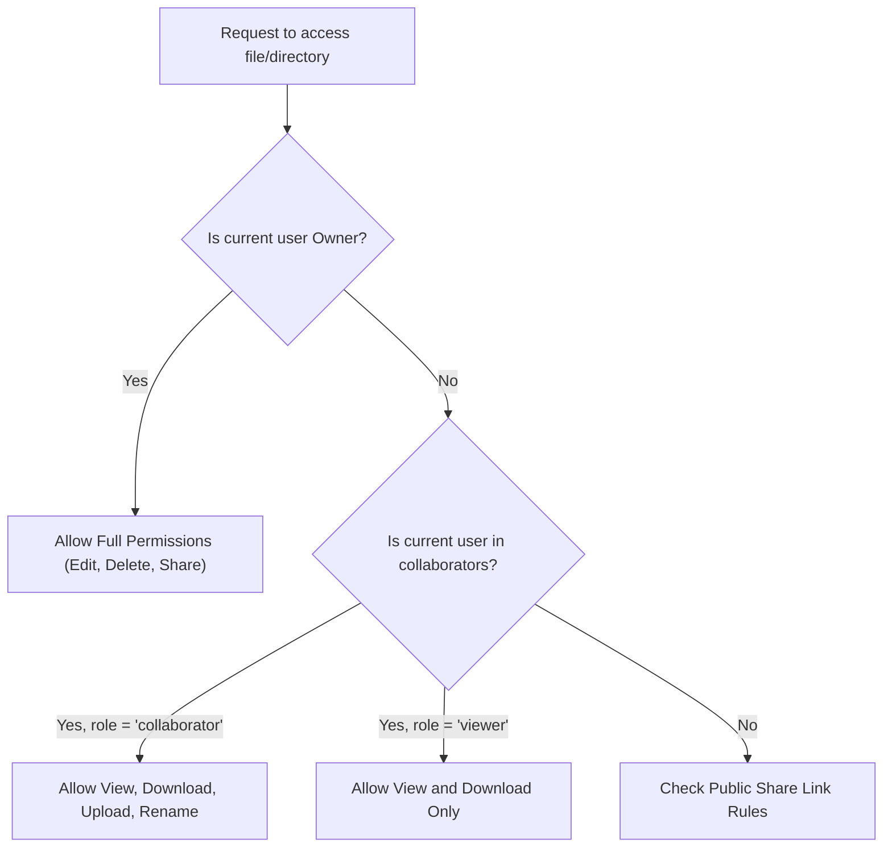

### 7.2 Public Share Links & Sparsely Indexed Tokens
When link sharing is toggled on, the server generates a cryptographically random `shareToken` stored with a sparse index in MongoDB.

### 7.3 Security Key (Password) Protection with Salted Hashing
Users can password-protect public share links. The password is never stored in plain text; it is hashed using a salted cryptographic algorithm.

### 7.4 Time-Bound Expiring Share Links
Link settings support automatic expiration (`1h`, `24h`, `7d`, `30d`). When the expiration timestamp passes, the endpoint returns `410 Gone`.

### 7.5 Public Access Challenge & Verification Flow
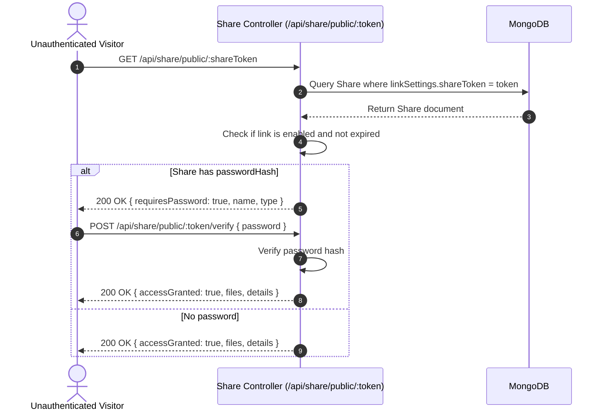

---

## 8. Trash, Soft Delete & Irreversible Cascade Wiping

### 8.1 Two-Stage Soft Deletion (Move to Trash)
When an item is deleted:
1. Marked with `isTrashed: true` and `trashedAt: new Date()`.
2. Stores `originalParentDirId: parentDirId` so it can be restored to its exact original location.
3. If it is a folder, all descendant files and subdirectories are also marked with `isTrashed: true`.

### 8.2 Trash Restoration with Fallback to Root
When restored:
1. Verifies if `originalParentDirId` still exists and is not currently trashed.
2. If the original parent folder was deleted, the restored item automatically falls back to the user's `rootDirId` so it is never orphaned.
3. Sets `isTrashed: false` recursively across all descendants.

### 8.3 Permanent Cascade Deletion with ACID Transaction
When a user clicks "Delete Permanently" on a folder:

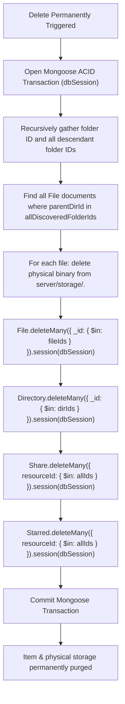

### 8.4 Empty Trash Bulk Cleanup
Executes the permanent cascade deletion pipeline across every item where `userId = currentUser._id` and `isTrashed = true`.

---

## 9. Sensitive Account Lifecycle & Identity Operations

### 9.1 Dual-OTP Email Migration Pipeline
Guarantees that an account email cannot be changed without authenticating both the old inbox and the new inbox:

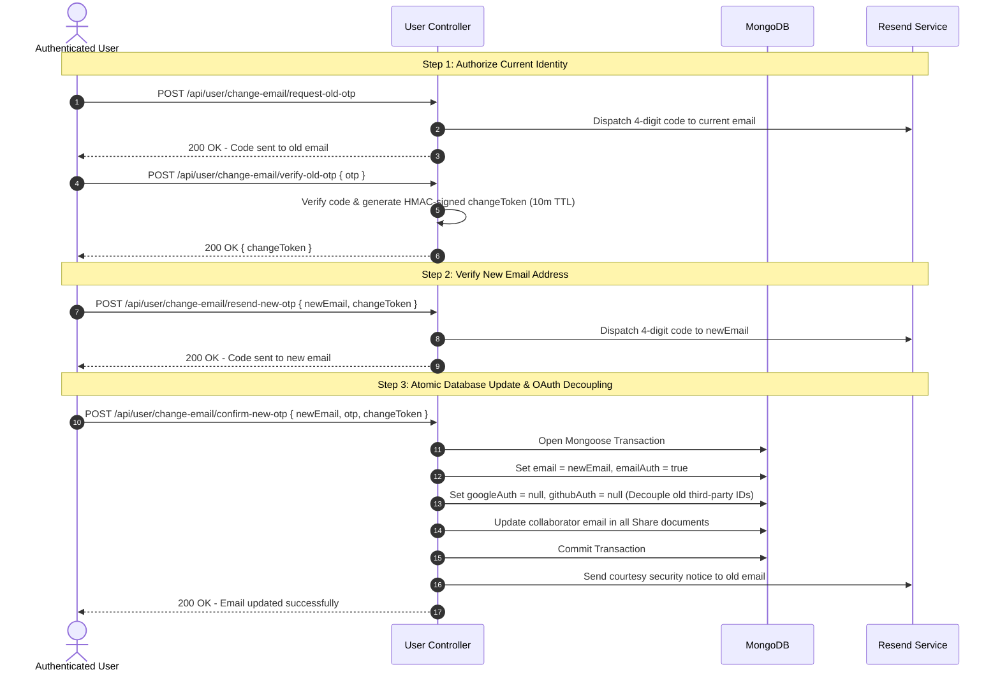

### 9.2 Account Ownership Transfer
Enables users to transfer all their files, directories, shares, and data to another verified user email:
1. Validates recipient account exists and is not the current user.
2. Sends authorization OTP to current owner.
3. In an ACID transaction:
   - Reassigns `userId` of all files, folders, and shares to the recipient.
   - Deletes current user document and active sessions.

### 9.3 Permanent Account Self-Deletion
1. User requests deletion OTP.
2. User submits confirmation with OTP.
3. In an ACID transaction:
   - Discovers all files and deletes them from physical disk.
   - Deletes all Directory, File, Share, Starred, Session, and User records.
   - Clears session cookies.

---

## 10. File & Folder Relocation (Move Engine)

### 10.1 Circular Dependency Detection & Move Execution
When moving a folder to a new destination, MeghVault prevents cyclic moves (e.g., attempting to move a folder into itself or into one of its own subdirectories):

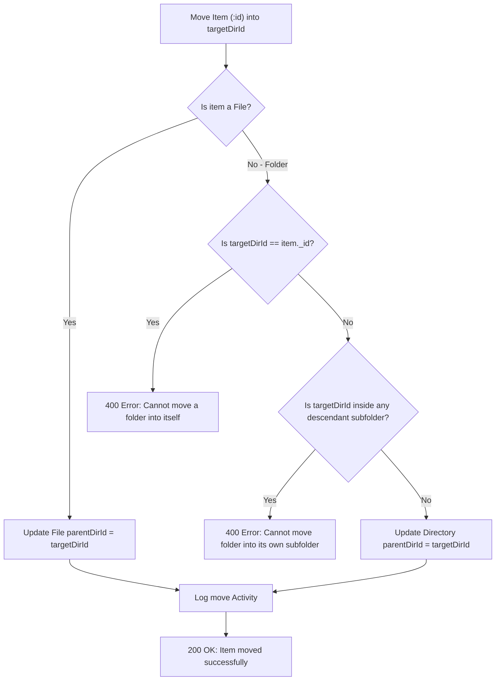

---

## 11. Starred / Favorites System

Allows users to favorite files and folders for instant access:
- `POST /api/starred`: Adds resource to favorites with a compound unique index `{ userId: 1, resourceId: 1 }`.
- `DELETE /api/starred/:resourceId`: Removes from favorites.
- `GET /api/starred`: Returns populated favorite files and folders.

---

## 12. Activity Logging & Audit Feed Stream

Tracks every mutating event across the drive:
- Captured actions: `upload`, `view`, `download`, `rename`, `share`, `star`, `restore`, `trash`, `import`, `move`.
- Provides a chronological activity timeline accessible via `GET /api/recent` or `GET /api/activity`.

---

## 13. Metadata Details Inspector

`GET /api/details/:resourceType/:resourceId`:
Fetches an in-depth inspector payload:
- File name, extension, MIME type, file size in bytes and human-readable format.
- Absolute breadcrumb trail path.
- Creation timestamp and last modification date.
- Collaborator count and active share settings.

---

## 14. Administrative Governance & Dashboard

Accessible only to users with `role: "Admin"` via `adminVerify` middleware:
- System storage consumption statistics.
- Total registered user count and role management.
- System-wide activity logs and security audits.

---

## 15. MongoDB Document Architecture & Schema Design (NoSQL)

MeghVault uses **MongoDB** as a high-throughput, flexible document database. Instead of traditional SQL tables, foreign key constraints, and relational joins, MeghVault leverages native NoSQL design patterns:

- **Hybrid Embedding & Referencing**:
  - **Embedded Subdocuments**: Subdocuments with 1-to-few lifecycles (`authProvider`, `integrations`, `collaborators[]`, `linkSettings`, and audit `details`) are embedded directly inside their parent documents. This provides atomic updates and zero-join read operations in a single query.
  - **Normalized References (`ObjectId`)**: Unbounded 1-to-many relationships (e.g. hundreds of thousands of files and subdirectories belonging to a user or parent directory) use normalized references (`ref: 'Directory'`, `ref: 'User'`). This prevents document sizes from ever approaching MongoDB's 16MB BSON limit.
- **Tree Hierarchy Modeling**: Directories use the **Parent-Referencing Pattern** (`parentDirId` pointing upward to the parent `Directory._id`), enabling fast subtree lookups, dynamic breadcrumb path traversal, and circular dependency checks.
- **Automated TTL & Specialized Indexing**: MongoDB native TTL indexes automatically garbage-collect expired sessions (7 days) and OTP records (3 minutes) at the storage engine level without background cron workers.
- **Multi-Document ACID Transactions**: Coordinated through a MongoDB Replica Set (`dbSession.withTransaction()`) for operations requiring all-or-nothing guarantees (cascade folder deletion, email migration, account transfers).

---

### 15.1 MongoDB Document Model & Collection Topologies

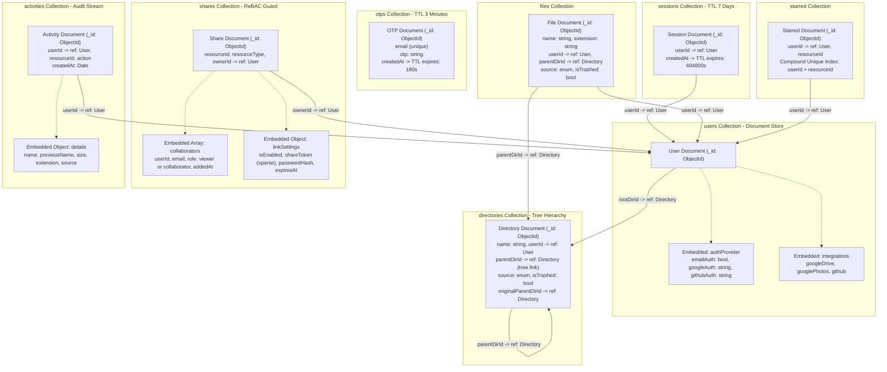

---

### 15.2 Detailed BSON Collection Schemas

#### 1. `users` Collection
Stores user identity, role, credentials, and third-party cloud integration states.
```javascript
{
  _id: ObjectId("..."),
  email: "user@example.com",              // Unique, indexed, normalized lowercase
  name: "Kunal Rathore",                 // Optional display name
  profile: "<svg>...</svg>",              // SVG string or avatar image URL
  role: "User",                          // Enum: ["User", "Admin"]
  rootDirId: ObjectId("..."),             // Reference to User's root Directory
  authProvider: {                        // Embedded Subdocument
    emailAuth: true,                     // Boolean: verified via email OTP
    googleAuth: "109823487123984",       // Google OAuth profile ID (or null)
    githubAuth: "84729103"               // GitHub profile ID (or null)
  },
  integrations: {                        // Embedded Subdocument
    googleDrive: {
      connected: true,
      refreshToken: "iv:tag:cipher",    // AES-256-GCM encrypted refresh token
      accessToken: "ya29....",
      expiryDate: 1731580000000,
      email: "user@gmail.com"
    },
    googlePhotos: {
      connected: true,
      refreshToken: "iv:tag:cipher",    // AES-256-GCM encrypted refresh token
      accessToken: "ya29....",
      expiryDate: 1731580000000
    },
    github: {
      connected: true,
      accessToken: "gho_....",
      username: "kunal-rathore"
    }
  },
  preferences: {
    theme: "dark"                        // Enum: ["dark", "light", "system"]
  },
  createdAt: ISODate("2026-11-14T00:00:00Z"),
  updatedAt: ISODate("2026-11-14T12:00:00Z")
}
```

#### 2. `directories` Collection
Hierarchical Virtual File System tree nodes utilizing the parent-referencing pattern.
```javascript
{
  _id: ObjectId("..."),
  name: "Project Reports",               // Folder display name
  userId: ObjectId("..."),                // Reference -> users._id
  parentDirId: ObjectId("..."),           // Reference -> directories._id (null for root)
  source: "meghvault",                   // Enum: ["meghvault", "google-drive", "google-photos", "github"]
  isTrashed: false,                      // Two-stage soft deletion flag
  trashedAt: null,                       // Timestamp of soft deletion
  trashedDirectly: false,                // True if user clicked trash on this specific folder
  originalParentDirId: null              // Preserved parentDirId for restoration fallback
}
```

#### 3. `files` Collection
Virtual file metadata records mapped directly to physical disk storage binaries.
```javascript
{
  _id: ObjectId("..."),                   // Matches physical binary file: server/storage/<_id>.<ext>
  name: "Quarterly_Financials.pdf",      // File name with extension
  extension: ".pdf",                     // Normalized extension with leading dot
  userId: ObjectId("..."),                // Reference -> users._id
  parentDirId: ObjectId("..."),           // Reference -> directories._id
  source: "meghvault",                   // Enum: ["meghvault", "google-drive", "google-photos", "github"]
  isTrashed: false,                      // Two-stage soft deletion flag
  trashedAt: null,                       // Timestamp of soft deletion
  trashedDirectly: false,                // True if user deleted this file directly
  originalParentDirId: null              // Preserved parentDirId for restoration fallback
}
```

#### 4. `shares` Collection
ReBAC authorization document containing embedded collaborator lists and public link settings.
```javascript
{
  _id: ObjectId("..."),
  resourceId: ObjectId("..."),           // Target file or directory _id
  resourceType: "directory",             // Enum: ["file", "directory"]
  ownerId: ObjectId("..."),               // Reference -> users._id
  collaborators: [                       // Embedded Array of Subdocuments
    {
      userId: ObjectId("..."),           // Reference -> users._id
      name: "Alex Smith",
      email: "alex@example.com",
      avatar: "https://...",
      role: "collaborator",              // Enum: ["viewer", "collaborator"]
      addedAt: ISODate("2026-11-14T10:00:00Z")
    }
  ],
  linkSettings: {                        // Embedded Subdocument
    isEnabled: true,                     // Boolean: public link access switch
    shareToken: "a7b3c9e2f1d4...",       // Unique cryptographic token (Sparse Index)
    visibility: "public",                // Enum: ["restricted", "public"]
    passwordHash: "$2b$10$e9X...",       // Salted cryptographic hash (or null)
    expiresAt: ISODate("2026-11-21T00:00:00Z") // Automatic link expiration date (or null)
  }
}
```

#### 5. `sessions` & `otps` Collections (Automatic TTL Indexing)
Ephemeral operational collections with automatic MongoDB storage-engine expiry.
```javascript
// sessions Collection (TTL 7 Days)
{
  _id: ObjectId("..."),                   // Matches signed session cookie 'sid'
  userId: ObjectId("..."),                // Reference -> users._id
  createdAt: ISODate("2026-11-14T00:00:00Z") // Automatically purged by MongoDB after 7 days
}

// otps Collection (TTL 3 Minutes)
{
  _id: ObjectId("..."),
  email: "user@example.com",              // Unique constraint
  otp: "4829",                           // 4-digit verification code
  createdAt: ISODate("2026-11-14T12:30:00Z") // Automatically purged by MongoDB after 180 seconds
}
```

#### 6. `starred` & `activities` Collections
User bookmarking and chronological audit log feeds.
```javascript
// starred Collection
{
  _id: ObjectId("..."),
  userId: ObjectId("..."),                // Reference -> users._id
  resourceType: "file",                  // Enum: ["file", "directory"]
  resourceId: ObjectId("..."),           // Reference -> files._id or directories._id
  createdAt: ISODate("..."),
  updatedAt: ISODate("...")
}

// activities Collection (Chronological Event Stream)
{
  _id: ObjectId("..."),
  userId: ObjectId("..."),                // Reference -> users._id
  resourceType: "file",                  // Enum: ["file", "directory"]
  resourceId: ObjectId("..."),           // Reference -> files._id or directories._id
  action: "upload",                      // Enum: ["upload", "view", "download", "rename", "share", "star", "restore", "trash", "import", "move"]
  details: {                             // Embedded Subdocument (Polymorphic Event Metadata)
    name: "Quarterly_Financials.pdf",
    previousName: null,
    size: 2458900,
    extension: ".pdf",
    source: "meghvault",
    fromDirectoryName: null,
    toDirectoryName: null,
    sharedWithEmail: null
  },
  createdAt: ISODate("2026-11-14T12:00:00Z")
}
```

---

### 15.3 Index Optimization & Query Performance Strategy

MeghVault creates targeted MongoDB indexes to guarantee sub-millisecond query execution across large datasets:

| Collection | Index Specification | Index Type | Purpose |
| :--- | :--- | :--- | :--- |
| `users` | `{ email: 1 }` | Unique Index | Instant O(1) user lookups and strict duplicate prevention |
| `otps` | `{ email: 1 }` | Unique Index | Ensures only one active OTP per email address |
| `otps` | `{ createdAt: 1 }` | **TTL Index (180s)** | Automatic hardware deletion of expired verification codes after 3 minutes |
| `sessions`| `{ createdAt: 1 }` | **TTL Index (604800s)**| Automatic removal of stale session records after 7 days |
| `shares` | `{ "linkSettings.shareToken": 1 }` | **Sparse Index** | Ultra-fast token lookup on public share links while ignoring nulls |
| `shares` | `{ resourceId: 1, resourceType: 1 }` | Compound Index | Rapid ReBAC permission checks on file/folder access |
| `starred` | `{ userId: 1, resourceId: 1 }` | **Compound Unique** | Prevents a user from bookmarking the same item multiple times |
| `starred` | `{ userId: 1, resourceType: 1 }` | Compound Index | Fast retrieval of starred files vs starred folders |
| `directories` | `{ parentDirId: 1, isTrashed: 1 }` | Compound Index | High-speed directory browsing and subtree discovery |
| `files` | `{ parentDirId: 1, isTrashed: 1 }` | Compound Index | High-speed file listing inside active folder views |
| `activities` | `{ userId: 1, createdAt: -1 }` | Descending Compound | Fast rendering of the user's chronological activity audit feed |

---

### 15.4 Multi-Document ACID Transactions (MongoDB Replica Set)

Because cloud storage operations require atomic consistency across multiple collections and physical files, MeghVault runs all critical operations inside **Mongoose Multi-Document Transactions** (`dbSession.withTransaction()`):

```mermaid
flowchart TD
    subgraph ACIDTransaction["Mongoose Session Transaction (dbSession)"]
        T1["1. Query Folder & Recursively Discover All Descendants"]
        T1 --> T2["2. Delete Physical Binary Files from server/storage via deletePhysicalFile()"]
        T2 --> T3["3. File.deleteMany({ _id: { $in: fileIds } }).session(dbSession)"]
        T3 --> T4["4. Directory.deleteMany({ _id: { $in: dirIds } }).session(dbSession)"]
        T4 --> T5["5. Share.deleteMany({ resourceId: { $in: allIds } }).session(dbSession)"]
        T5 --> T6["6. Starred.deleteMany({ resourceId: { $in: allIds } }).session(dbSession)"]
    end

    ACIDTransaction --> Status{"Any Step Failed / Network Error?"}
    Status -->|Yes| Rollback["Abort Transaction: Zero Database Changes Committed"]
    Status -->|No| Commit["Commit Transaction: Atomic Consistency Guaranteed"]
```

#### Operations Protected by MongoDB Transactions:
1. **Permanent Recursive Cascade Deletion**: Deletes target directory, all nested subdirectories, all files, all associated shares, and physical binaries with zero orphaned documents.
2. **Account Ownership Transfer**: Atomically transfers ownership of every directory, file, and share to the recipient while deleting the originating user account.
3. **Dual-OTP Email Migration**: Atomically updates user email, detaches obsolete Google/GitHub OAuth IDs, and updates collaborator email strings across all active `shares` collections.

---

## 16. REST API Complete Catalog

| Category | Method | Endpoint | Protection | Description |
| :--- | :--- | :--- | :--- | :--- |
| **Auth** | `POST` | `/api/auth/send-otp` | Rate Limiter | Send passwordless login OTP |
| **Auth** | `POST` | `/api/auth/verify-otp` | Rate Limiter + Throttler | Verify OTP and create/open session |
| **Auth** | `GET` | `/auth/google` | Public | Initiate Google OAuth 2.0 flow |
| **Auth** | `GET` | `/auth/google/callback` | State Check | Google OAuth 2.0 callback |
| **Auth** | `GET` | `/auth/github` | Public | Initiate GitHub OAuth 2.0 flow |
| **Auth** | `GET` | `/auth/github/callback` | State Check | GitHub OAuth 2.0 callback |
| **Directory** | `GET` | `/api/directory/:id` | `checkAuth` | List directory contents & breadcrumbs |
| **Directory** | `POST` | `/api/directory` | `checkAuth` + Zod | Create new folder under root |
| **Directory** | `POST` | `/api/directory/:id` | `checkAuth` + Zod | Create subfolder under parent |
| **Directory** | `PATCH` | `/api/directory/:id` | `checkAuth` + Zod | Rename directory |
| **Directory** | `DELETE`| `/api/directory/:id` | `checkAuth` | Soft delete directory |
| **Directory** | `GET` | `/api/directory/:id/download` | `checkAuth` | Stream folder contents as recursive ZIP |
| **File** | `POST` | `/api/file/:parentDirId?` | `checkAuth` | Stream binary file upload to disk |
| **File** | `GET` | `/api/file/:id/:filename?` | `checkAuth` / Ticket | Stream, preview, or download file |
| **File** | `PATCH` | `/api/file/:id` | `checkAuth` + Zod | Rename file preserving extension |
| **File** | `DELETE`| `/api/file/:id` | `checkAuth` | Soft delete file |
| **Google Drive** | `GET` | `/api/google-drive/auth-url` | `checkAuth` | Get Google Drive OAuth link |
| **Google Drive** | `GET` | `/api/google-drive/list` | `checkAuth` | Browse items in Google Drive |
| **Google Drive** | `POST` | `/api/google-drive/import` | `checkAuth` + Zod | Stream chosen Drive files into MeghVault |
| **Google Photos**| `POST` | `/api/google-photos/picker-session` | `checkAuth` | Create Google Photos picker session |
| **Google Photos**| `POST` | `/api/google-photos/import` | `checkAuth` + Zod | Stream chosen Photos items into MeghVault |
| **GitHub** | `GET` | `/api/github/repos` | `checkAuth` | Fetch linked user GitHub repositories |
| **GitHub** | `POST` | `/api/github/import` | `checkAuth` + Zod | Import repo as ZIP or directory structure |
| **Sharing** | `GET` | `/api/share/:resourceType/:resourceId` | `checkAuth` | Inspect collaborators & link settings |
| **Sharing** | `POST` | `/api/share/collaborator` | `checkAuth` + Zod | Add collaborator (`viewer`/`collaborator`) |
| **Sharing** | `DELETE`| `/api/share/collaborator` | `checkAuth` + Zod | Remove collaborator access |
| **Sharing** | `PATCH` | `/api/share/link-settings` | `checkAuth` + Zod | Update public link, password & expiry |
| **Sharing** | `GET` | `/api/share/public/:shareToken` | Public | Access shared resource via link |
| **Sharing** | `POST` | `/api/share/public/:shareToken/verify` | Throttler | Verify password on protected link |
| **Trash** | `GET` | `/api/trash` | `checkAuth` | List all trashed files & folders |
| **Trash** | `POST` | `/api/trash/:resourceType/:resourceId/restore` | `checkAuth` | Restore item back to parent folder |
| **Trash** | `DELETE`| `/api/trash/:resourceType/:resourceId` | `checkAuth` | Irreversible atomic cascade deletion |
| **Trash** | `DELETE`| `/api/trash` | `checkAuth` | Empty trash (wipe all trashed items) |
| **Move** | `POST` | `/api/items/move` | `checkAuth` + Zod | Relocate items with cyclic check |
| **Starred** | `GET` | `/api/starred` | `checkAuth` | Fetch user's starred favorites |
| **Starred** | `POST` | `/api/starred` | `checkAuth` + Zod | Star a file or folder |
| **Starred** | `DELETE`| `/api/starred/:resourceId` | `checkAuth` | Unstar a resource |
| **Activity** | `GET` | `/api/recent` | `checkAuth` | Fetch chronological audit feed |
| **Details** | `GET` | `/api/details/:resourceType/:resourceId` | `checkAuth` | Inspect deep resource metadata |
| **User** | `GET` | `/api/user` | `checkAuth` | Get user profile & active sessions |
| **User** | `PATCH` | `/api/user/profile` | `checkAuth` + Zod | Update user display name & avatar |
| **User** | `POST` | `/api/user/logout` | Public | Log out current browser session |
| **User** | `POST` | `/api/user/logout-all` | `checkAuth` | Revoke all active user sessions |
| **User** | `POST` | `/api/user/change-email/request-old-otp` | `checkAuth` | Step 1: Send OTP to old email |
| **User** | `POST` | `/api/user/change-email/verify-old-otp` | `checkAuth` | Step 2: Verify old OTP, return HMAC |
| **User** | `POST` | `/api/user/change-email/resend-new-otp` | `checkAuth` | Step 3: Send verification to new email |
| **User** | `POST` | `/api/user/change-email/confirm-new-otp` | `checkAuth` + Throttler | Step 4: Atomic commit & OAuth cleanup |
| **User** | `POST` | `/api/user/transfer-ownership/request-otp` | `checkAuth` | Send ownership transfer OTP |
| **User** | `POST` | `/api/user/transfer-ownership/confirm` | `checkAuth` + Throttler | Atomically transfer all assets |
| **User** | `POST` | `/api/delete-account/request-otp` | `checkAuth` | Send account deletion OTP |
| **User** | `DELETE`| `/api/delete-account` | `checkAuth` + Throttler | Irreversible atomic account purge |

---
